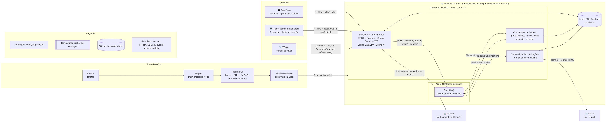

# Saneia API · Global Solution 2026/2 (CitizenTech)

Backend em **Java 21 + Spring Boot 3.5** do **Saneia**. O Saneia junta leituras de sensores de nível em reservatórios de esgoto (simulados no Wokwi) com relatos dos moradores. Com isso, a operadora (prefeitura ou concessionária) localiza os problemas, prioriza e registra o atendimento até o desfecho. A API é a mesma consumida pelo app mobile [SaneiaMobile](https://github.com/2TDSPO-JPG/SaneiaMobile) e segue o contrato `docs/api.md` daquele repositório.

> **Benefício ao cidadão:** comunidades com saneamento precário ganham um canal com protocolo e acompanhamento. Ao mesmo tempo, o monitoramento antecipa extravasamentos antes que o morador seja atingido (ODS 6 e ODS 11).

| | |
| --- | --- |
| **Deploy (Azure App Service)** | `https://saneia-api-<RM>.azurewebsites.net/api` → *substitua pelo link real após rodar o script* |
| **Swagger** | `/api/swagger-ui.html` |
| **Painel admin (Thymeleaf)** | `/api/painel` · login `admin@saneia.test` |
| **Requisito 5 escolhido** | **Opção A: RabbitMQ**, com eventos publicados e consumidos de forma assíncrona |
| **IA generativa** | Spring AI (cliente OpenAI) + **Gemini**: resumo dos indicadores de cada equipamento para a operadora |
| **Alerta por e-mail** | Quando uma área entra em **risco máximo**, o consumidor da fila envia e-mail HTML aos destinatários |

---

## Sumário

1. [Arquitetura](#arquitetura)
2. [Como rodar](#como-rodar)
3. [Usuários de teste](#usuários-de-teste)
4. [Endpoints principais](#endpoints-principais)
5. [Requisitos de Java Advanced](#requisitos-de-java-advanced)
6. [Arquitetura distribuída (RabbitMQ)](#arquitetura-distribuída-rabbitmq)
7. [Funcionalidade com Spring AI](#funcionalidade-com-spring-ai)
8. [Painel administrativo e alerta por e-mail](#painel-administrativo-e-alerta-por-e-mail)
9. [Banco de dados](#banco-de-dados)
10. [DevOps e nuvem (Azure)](#devops-e-nuvem-azure)
11. [CRUD em JSON](#crud-em-json)
12. [Testes](#testes)
13. [Declaração de uso de IA](#declaração-de-uso-de-ia)
14. [Integrantes](#integrantes)

---

## Arquitetura



Fonte do desenho: [`docs/arquitetura.mmd`](docs/arquitetura.mmd) (Mermaid).

**Fluxos principais**

1. **Relato do morador.** App → `POST /reports` (JWT). A API gera o protocolo, aplica a regra de recorrência, vincula o sensor que cobre o local e grava no Azure SQL. Em seguida publica `report.opened`, e o consumidor gera as notificações.
2. **Leitura do sensor.** Wokwi → HiveMQ → `POST /telemetry/readings` (chave do dispositivo). A API valida a leitura e publica `telemetry.reading` na fila. O consumidor grava o histórico, avalia o limite e a previsão, e abre, agrava ou encerra eventos. Quando o ponto entra em alerta, publica `sensor.alert`.
3. **Atendimento.** A operadora vê o mapa (`GET /sensors`, consultado a cada 5 s pelo app) e a fila (`GET /reports`). Ela atualiza o protocolo (`received → in_progress → closed`) e o morador é notificado pela fila.
4. **Insights.** A operadora pede o resumo do período. O backend calcula os indicadores no banco e o LLM só redige a explicação.
5. **Risco máximo.** Quando um ponto atinge o limite, o consumidor de `sensor.alert` envia um e-mail HTML para os destinatários de alerta e registra cada envio. O painel administrativo mostra o mapa de risco por área em tempo real.

**Pacotes** (`br.com.saneia.api`): `auth` (login/JWT), `panel` (painel Thymeleaf), `alert` (e-mail de risco máximo), `user`, `sensor` (catálogo, cobertura, previsão), `telemetry` (ingestão e consumidor), `report` (relatos e regras), `file` (fotos com URL assinada), `insight` (Spring AI), `messaging` (RabbitMQ), `notification`, `common` (erros, paginação, geo) e `config`.

---

## Como rodar

**Pré-requisitos:** JDK 21. O Maven vem junto pelo wrapper `mvnw`. O Docker é opcional e serve para o RabbitMQ.

### Opção 1: direto no IntelliJ ou no Maven (mais simples)

Rode `SaneiaApiApplication` no IntelliJ ou:

```bash
./mvnw spring-boot:run          # Windows: .\mvnw.cmd spring-boot:run
```

No perfil `local`, a mensageria roda em modo **inline**: os mesmos eventos e consumidores, executados logo após o commit, sem precisar do RabbitMQ.

### Opção 2: com RabbitMQ de verdade (filas visíveis no painel do broker)

```bash
docker compose -f dockerfiles/docker-compose.yml up -d rabbitmq
SANEIA_MESSAGING_MODE=rabbit RABBIT_HEALTH=true ./mvnw spring-boot:run
# PowerShell: $env:SANEIA_MESSAGING_MODE="rabbit"; $env:RABBIT_HEALTH="true"; .\mvnw.cmd spring-boot:run
```

Painel do RabbitMQ: http://localhost:15672 (guest / guest), onde aparecem as filas `saneia.*`.

### Opção 3: tudo em containers

```bash
docker compose -f dockerfiles/docker-compose.yml up --build
```

Nas três opções: API em http://localhost:8080/api · Swagger em http://localhost:8080/api/swagger-ui.html · painel admin em http://localhost:8080/api/painel

O perfil padrão (`local`) usa **H2 em memória** e já cria as contas de teste e um cenário de demonstração: 4 reservatórios com histórico, alarmes e 2 relatos.

### Com Oracle (ex.: Oracle da FIAP)

```bash
export SPRING_PROFILES_ACTIVE=oracle
export DB_URL=jdbc:oracle:thin:@oracle.fiap.com.br:1521/ORCL DB_USER=rmXXXXX DB_PASSWORD=******
export JWT_SECRET=$(openssl rand -hex 32) SEED_ADMIN_PASSWORD=... SEED_OPERATOR_PASSWORD=... SEED_RESIDENT_PASSWORD=...
./mvnw spring-boot:run
```

### Variáveis de ambiente

| Variável | Uso | Padrão local |
| --- | --- | --- |
| `SPRING_PROFILES_ACTIVE` | `local` (H2), `oracle` ou `azure` (Azure SQL) | `local` |
| `DB_URL` / `DB_USER` / `DB_PASSWORD` | Conexão JDBC | H2 em memória |
| `JWT_SECRET` | Segredo HS256 do token (≥ 32 caracteres) | só no perfil local |
| `RABBITMQ_HOST` / `RABBITMQ_PORT` / `RABBITMQ_USER` / `RABBITMQ_PASSWORD` | Broker | `localhost:5672 guest/guest` |
| `SANEIA_MESSAGING_MODE` | `rabbit` ou `inline` | `inline` no perfil local, `rabbit` na nuvem |
| `GEMINI_API_KEY` | Chave do Gemini para os insights. Sem ela, a API devolve o resumo calculado | vazio |
| `AI_MODEL` / `AI_BASE_URL` | Modelo e endpoint compatível com OpenAI | `gemini-2.5-flash` |
| `DEVICE_KEY` | Chave do dispositivo IoT (`X-Device-Key`) | `local-device-key` |
| `SEED_*_PASSWORD` | Senhas das contas provisionadas | `Saneia2026!` só no local |
| `TELEMETRY_INTERVAL_MINUTES` | Intervalo esperado entre leituras (offline após 2×) | `30` |
| `CORS_ORIGINS` | Origens liberadas | `*` |
| `SPRING_MAIL_HOST` / `_PORT` / `_USERNAME` / `_PASSWORD` | SMTP do e-mail de risco máximo | vazio (não envia) |
| `MAIL_FROM` / `ALERT_EMAILS` | Remetente e destinatários fixos dos alertas | — |
| `PUBLIC_URL` | URL pública usada no link do e-mail | `http://localhost:8080/api` |

### Conectar o app mobile

No `.env.local` do SaneiaMobile:

```dotenv
EXPO_PUBLIC_API_URL=http://<IP-do-computador>:8080/api      # local
EXPO_PUBLIC_API_URL=https://saneia-api-<RM>.azurewebsites.net/api   # nuvem
```

O CORS já libera `Authorization`, `Content-Type` e o preflight `OPTIONS`.

---

## Usuários de teste

O cadastro público (`POST /auth/signup`) cria **apenas moradores**. A operadora e a administração são provisionadas pelo backend na subida.

| Perfil | E-mail | Senha (local e nuvem da avaliação) | Pode |
| --- | --- | --- | --- |
| Morador (`resident`) | `morador@saneia.test` | `Saneia2026!` | Abrir, editar e excluir os próprios relatos em `received`, complementar e consultar cobertura |
| Operadora (`operator`) | `operadora@saneia.test` | `Saneia2026!` | Mapa, ficha, insights, fila de relatos, status e avaliação técnica |
| Administrador (`admin`) | `admin@saneia.test` | `Saneia2026!` | Usuários, CRUD do catálogo de equipamentos e **painel web** `/api/painel` |

Na nuvem, as senhas vêm das variáveis `SEED_*_PASSWORD` do App Service, e não do código.

---

## Endpoints principais

Base: `/api`. Rotas protegidas recebem `Authorization: Bearer <token>`. Os erros seguem `{ "message", "code", "status", "path", "timestamp", "errors"? }`. As listas são arrays JSON paginados por `page` e `size`, com totais nos cabeçalhos `X-Total-Count`, `X-Total-Pages`, `X-Page` e `X-Page-Size`. Assim o formato do app não muda.

| Método e rota | Papel | Descrição |
| --- | --- | --- |
| `POST /auth/signup` | público | Cadastra morador e devolve `{ token, user }` |
| `POST /auth/login` | público | Login → `{ token, expiresAt, user: { id, name, email, role } }` |
| `GET /reports` | morador / operadora | Próprios relatos ou fila completa (recorrentes primeiro) |
| `GET /reports/{id}` | dono / operadora | Detalhe com `updates` e `assessment` (só operadora) |
| `POST /reports` | morador | JSON ou multipart (`report` = JSON, `photo` = imagem). 409 `REPORT_COOLDOWN` |
| `PATCH /reports/{id}` | morador | Edita em `received`; sem nova foto, mantém a anterior |
| `DELETE /reports/{id}` | morador | Exclusão lógica em `received` → 204 |
| `PATCH /reports/{id}/status` | operadora | `status`, `resolution`, `progressNote` e `outcome` opcional (`resolved`, `stabilized`, `unfounded`, `forwarded`) |
| `POST /reports/{id}/updates` | morador | Complemento (nota e/ou foto) sem novo protocolo |
| `POST /reports/{id}/assessment` | operadora | Solicita avaliação técnica (1–600 caracteres) |
| `POST /reports/{id}/reopen` | operadora | Reabre um protocolo encerrado (o problema voltou), com motivo |
| `GET /coverage?latitude=&longitude=` | autenticado | `{ sensorId, status }` ou ambos `null` |
| `GET /sensors` · `GET /sensors/{id}` | operadora / admin | Mapa e ficha: estado, volume, previsão, amostras e eventos |
| `POST /sensors/{id}/insights` | operadora / admin | **Spring AI**: `{ summary, aiGenerated, indicators }` |
| `GET /admin/users` | admin | `id`, `name`, `email`, `role` |
| `GET/POST /admin/sensors` · `GET/PATCH/DELETE /admin/sensors/{id}` | admin | CRUD do catálogo (exclusão lógica) |
| `POST /telemetry/readings` | dispositivo (`X-Device-Key`) | Leitura do Wokwi → fila (202 Accepted) |
| `GET /notifications` · `PATCH /notifications/{id}/read` | autenticado | Avisos gerados pelo consumidor da fila |
| `GET /files/{id}?expires=&signature=` | URL assinada | Foto do relato (HMAC-SHA256, validade de 2 h) |
| `GET /about` · `GET /actuator/health` | público | Versão/build publicados e health check |

Respostas de autorização: **401** para sessão ausente ou inválida e **403** para conta autenticada sem o papel exigido.

---

## Requisitos de Java Advanced

| # | Requisito | Onde está |
| --- | --- | --- |
| 01 | API REST com ≥ 3 entidades relacionadas, CRUD com Spring Data JPA e paginação | 11 entidades (`AppUser`, `Sensor`, `SensorReading`, `SensorEvent`, `Report`, `ReportUpdate`, `ReportHistory`, `StoredFile`, `Notification`, `AlertRecipient`, `EmailLog`). CRUD de equipamentos e relatos. `PageRequest` + cabeçalhos `X-Total-*` (`common/PageResponses`) |
| 02 | Bean Validation nos DTOs + `@RestControllerAdvice` | DTOs `record` com `@NotBlank`, `@Size`, `@Pattern`, `@Positive` e `@DecimalMin/Max`, mais `common/GlobalExceptionHandler` com `ErrorResponse` padronizado |
| 03 | Spring Security + JWT com ≥ 2 papéis | `config/SecurityConfig` (resource server, HS256), `TokenService`, papéis `resident`/`operator`/`admin`, `hasRole` nas rotas e `@PreAuthorize` nos controllers, propriedade do relato checada no serviço |
| 04 | Spring AI integrado ao fluxo | `insight/InsightService` (insights do equipamento) e `insight/OperationsAiService` (resposta ao morador e boletim operacional), ambos com `ChatClient` |
| 05 | Arquitetura distribuída | **Opção A, RabbitMQ**: `messaging/*`, `telemetry/TelemetryProcessor`, `notification/NotificationService` |
| 06 | Swagger, README e integração com o Mobile | springdoc em `/api/swagger-ui.html` com autenticação Bearer. Contrato do SaneiaMobile implementado campo a campo |

**Regras de negócio implementadas no servidor:**
- Protocolo e data de abertura gerados no servidor. IDs em texto e datas ISO 8601.
- **Recorrência:** na mesma transação (com lock do morador), bloqueia em 20 dias a mesma categoria a até 75 m e responde `409 REPORT_COOLDOWN` com `existingReportId`. Protocolos encerrados não bloqueiam e os excluídos continuam contando. Passado o prazo, o novo relato é vinculado ao anterior aberto por `previousReportId`/`previousProtocol`.
- Cobertura pelo equipamento ativo mais próximo dentro do raio.
- Equipamento novo começa `offline`. A exclusão é lógica e preserva leituras e vínculos.
- Alarme com limite crítico, alerta por previsão (regressão linear das últimas 6 h, janela de 12 h) ou por 85% do limite. A normalização só ocorre após 2 leituras estáveis. Um alarme contínuo conta uma vez, e o ponto vira "Sem comunicação" após 2× o intervalo esperado.

---

## Arquitetura distribuída (RabbitMQ)

**Opção A**, com evento publicado e consumido de forma assíncrona.

- **Exchange** `saneia.events` (topic). As **filas** são `saneia.telemetry.readings` (`telemetry.reading`) e `saneia.notifications` (`report.#`, `sensor.#`). Há uma **DLQ** `saneia.events.dlq` para mensagens rejeitadas após 3 tentativas.
- **Publicação depois do commit** (`messaging/AfterCommit`): o evento só sai se os dados foram gravados.
- **Fluxo IoT:** `POST /telemetry/readings` valida e publica, respondendo `202`. O `@RabbitListener` consome, grava o histórico, avalia a prioridade e, se houver alerta, **publica um novo evento** `sensor.alert`, consumido pelo serviço de notificações.
- **Fluxo de relatos:** `report.opened`, `report.status` e `report.assessment` são consumidos e viram notificações para a operadora e para o morador (`GET /notifications`).
- Para testes e execução sem broker existe o modo `inline`, com os mesmos handlers chamados após o commit.

---

## Funcionalidade com Spring AI

`POST /sensors/{id}/insights` responde à pergunta da operadora: **"o que aconteceu com este reservatório no período e qual o risco?"**

1. O backend busca no banco as **medições e eventos** do período (`today`, `7d`, `30d`, `90d` ou `all`).
2. Calcula os **indicadores**: leituras, variação, pico, leituras no limite, alarmes e sua duração, tempo sem comunicação e estimativa até o limite.
3. Envia **só esses números** ao LLM pelo `ChatClient` do Spring AI, com um prompt de sistema que proíbe inventar valores.
4. Devolve `{ summary, aiGenerated, model, indicators }`. O app mostra o `summary` na ficha do equipamento.

O modelo **não define alarmes nem substitui as medições**. Sem `GEMINI_API_KEY`, ou se o provedor falhar, a API devolve um resumo calculado (`aiGenerated: false`), e a tela continua funcionando. O cidadão ganha com isso porque a operadora prioriza o ponto certo antes do extravasamento.

---

## Painel administrativo e alerta por e-mail

**Painel web em Thymeleaf** em `/api/painel` (no Azure: `https://saneia-api-<RM>.azurewebsites.net/api/painel`). O login é por formulário, com sessão e CSRF, usando as mesmas contas da API, e **só o papel admin entra**. A cadeia de segurança é separada da API (`SecurityConfig`, `@Order(1)`).

| Tela | O que mostra / permite |
| --- | --- |
| **Mapa ao vivo** | Mapa (Leaflet + OpenStreetMap) com os equipamentos coloridos por estado, o **raio de cobertura** de cada um e os chamados abertos coloridos pela prioridade, com filtros de camada |
| **Visão geral** | Chamados abertos, recebidos, em atendimento e encerrados (barra de estado), recorrências, **tempo médio de atendimento**, equipamentos por estado, chamados por categoria, e-mails enviados em 24 h, mapa de risco por área, pontos que precisam de atenção, últimos eventos e chamados. Atualiza a cada 30 s |
| **Risco por área** | Nível por bairro/região: **Risco máximo** (equipamento em alarme), **Alto** (alerta, recorrência ou 3+ chamados), **Moderado** (offline ou chamado aberto) e **Baixo** |
| **Chamados** | Filtros por status, prioridade, **fora do prazo** e busca; **ações em lote** (iniciar, encerrar em atendimento conjunto, atribuir, priorizar) e **exportação CSV** |
| **Detalhe do chamado** | **Edição completa** (categoria, descrição, endereço, bairro, **prioridade**, **responsável** e **vínculo manual com o sensor**), atendimento com **tipo de desfecho**, **reabertura** com motivo, **notas internas**, **texto sugerido pela IA** para o morador e **histórico completo** (auditoria) |
| **Equipamentos** | Volume × limite, previsão, alarmes em 6 meses, gráfico das últimas leituras, eventos e chamados vinculados |
| **Usuários** | Todas as contas e o formulário para **provisionar operadora e admin** |
| **Alertas por e-mail** | Destinatários (adicionar, pausar, remover), **e-mail de teste** e registro de cada envio (Enviado, Falhou, Não enviado) |

**Gestão do chamado:**

- **Prioridade e prazo (SLA).** A prioridade é sugerida na abertura: crítica se o sensor da área está em alarme; alta se há recorrência, alerta ou retorno de esgoto; baixa para mau cheiro ou outro problema sem cobertura; média nos demais casos. Os prazos são crítica 4 h, alta 24 h, média 72 h e baixa 7 dias. O painel e a API (campo `overdue`) indicam o que está fora do prazo.
- **Desfecho tipificado.** Resolvido, Estabilizado (em observação), Sem procedência ou Encaminhado.
- **Reabertura automática.** Se o chamado foi encerrado como *Estabilizado* e o sensor vinculado volta ao alarme em até 7 dias, o consumidor de `sensor.alert` reabre o protocolo e notifica o morador.
- **Auditoria.** A tabela `sn_report_history` registra abertura, edições campo a campo, status, prioridade, responsável, vínculo com sensor, reaberturas, complementos e notas internas, cada uma com autor e horário.
- **IA no atendimento.** O botão *Sugerir andamento/desfecho* redige a mensagem ao morador. O *Boletim operacional* resume a situação do dia para a gestão. Os dois usam Spring AI e têm texto de reserva quando não há chave configurada.

**E-mail de risco máximo:**

1. O consumidor grava a leitura e detecta o limite atingido.
2. Ele publica `sensor.alert`, que vai para a fila `saneia.notifications`.
3. O `AlertEmailService` monta um e-mail HTML (template Thymeleaf `email/alerta-risco.html`) com a área, o equipamento, o volume, o limite, os chamados abertos na região e o link para o painel.
4. O e-mail vai para cada destinatário ativo. Cada tentativa é gravada em `sn_email_logs`.

Leituras sucessivas no mesmo alarme **não repetem o e-mail**: um novo aviso só sai se o ponto normalizar e voltar ao limite.

Configuração do SMTP, por exemplo com Gmail e uma [senha de app](https://myaccount.google.com/apppasswords):

```bash
SPRING_MAIL_HOST=smtp.gmail.com  SPRING_MAIL_PORT=587
SPRING_MAIL_USERNAME=seu-email@gmail.com  SPRING_MAIL_PASSWORD=<senha de app>
MAIL_FROM="Saneia Alertas <seu-email@gmail.com>"   ALERT_EMAILS=plantao@exemplo.com   # opcional
```

Sem SMTP, a API funciona normalmente e o painel registra os alertas como "Não enviado".

---

## Banco de dados

- **Nuvem:** Azure SQL Database, com 11 tabelas. O DDL está em [`scripts/script-bd.sql`](scripts/script-bd.sql).
- **Oracle:** [`scripts/script-bd-oracle.sql`](scripts/script-bd-oracle.sql), para o perfil `oracle`.
- O catálogo (`sn_sensors`) fica separado do histórico (`sn_sensor_readings`) e dos eventos (`sn_sensor_events`).
- Consultas para comprovar o CRUD direto no banco: [`scripts/consultas-crud.sql`](scripts/consultas-crud.sql).

---

## DevOps e nuvem (Azure)

| Item | Arquivo |
| --- | --- |
| Provisionamento via Azure CLI (RG, Azure SQL, ACI RabbitMQ, App Service Java 21 e variáveis) | [`scripts/azure-infra.sh`](scripts/azure-infra.sh) |
| Remoção dos recursos | [`scripts/azure-cleanup.sh`](scripts/azure-cleanup.sh) |
| DDL do banco | [`scripts/script-bd.sql`](scripts/script-bd.sql) |
| Dockerfiles (API e RabbitMQ) e compose local | [`dockerfiles/`](dockerfiles) |
| Pipeline de Build (CI): Maven, JUnit, JaCoCo e artefato | [`azure-pipeline.yml`](azure-pipeline.yml) |
| Pipeline de Release (CD): deploy automático após novo artefato | [`azure-pipeline-release.yml`](azure-pipeline-release.yml) |
| Simulação de leituras para a demonstração | [`scripts/simular-leituras.sh`](scripts/simular-leituras.sh) |
| Passo a passo do Azure DevOps e roteiro dos vídeos | [`docs/ROTEIRO-ENTREGAS.md`](docs/ROTEIRO-ENTREGAS.md) |

```bash
az login
export RM=rm123456 SQL_ADMIN_PASSWORD='Senha-Forte-123' GEMINI_API_KEY='...'
bash scripts/azure-infra.sh
```

Nenhuma senha fica no código. Tudo vem de variáveis de ambiente do App Service e das pipelines.

---

## CRUD em JSON

Exemplos prontos em [`scripts/crud-json/`](scripts/crud-json). O campo `_rota` só indica onde enviar e é ignorado pela API.

<details>
<summary><b>Equipamentos (tabela sn_sensors), como admin</b></summary>

```http
POST /api/admin/sensors
Authorization: Bearer <token-admin>
Content-Type: application/json

{
  "prefix": "RES-21", "name": "Reservatório 21", "equipmentType": "Reservatório com sensor de nível",
  "address": "Rua das Palmeiras, 210", "neighborhood": "Setor Leste",
  "coordinate": { "latitude": -23.5530, "longitude": -46.6290 },
  "capacity": 2000, "limit": 1800, "radiusMeters": 200
}
```

- `GET /api/admin/sensors` e `GET /api/admin/sensors/{id}` (read)
- `PATCH /api/admin/sensors/{id}` com o mesmo corpo alterado (update)
- `DELETE /api/admin/sensors/{id}` → `204` (delete lógico)
</details>

<details>
<summary><b>Relatos (tabela sn_reports), como morador e operadora</b></summary>

```http
POST /api/reports
Authorization: Bearer <token-morador>
Content-Type: application/json

{
  "category": "Retorno de esgoto",
  "description": "Esgoto voltando pelo ralo do banheiro desde ontem à noite.",
  "address": "Rua das Palmeiras, 230", "neighborhood": "Setor Leste",
  "coordinate": { "latitude": -23.5531, "longitude": -46.6292 }
}
```

- `GET /api/reports` e `GET /api/reports/{id}` (read)
- `PATCH /api/reports/{id}` com o mesmo corpo, enquanto o relato está `received` (update do morador)
- `PATCH /api/reports/{id}/status` com `{ "status": "in_progress", "progressNote": "..." }` e depois `{ "status": "closed", "resolution": "..." }` (operadora)
- `DELETE /api/reports/{id}` → `204` (delete lógico)
</details>

<details>
<summary><b>Leitura do sensor (Wokwi)</b></summary>

```http
POST /api/telemetry/readings
X-Device-Key: <DEVICE_KEY>
Content-Type: application/json

{ "prefix": "RES-07", "volume": 1820, "levelCm": 182, "source": "Wokwi" }
```
</details>

---

## Testes

```bash
./mvnw verify
```

São **testes de integração** (MockMvc + H2) e **unitários** com JUnit 5. Cobrem autenticação, papéis (401/403), validação, CRUD de equipamentos, cobertura, fluxo de telemetria (alarme → normalização → offline), previsão, regra de 20 dias, exclusão lógica, multipart com URL assinada, complementos, fluxo da operadora, notificações, o resumo de insights, as telas do painel (login, CSRF, ações do admin) e o e-mail de risco máximo (com `JavaMailSender` simulado). A pipeline publica os relatórios JUnit (`target/surefire-reports`) e a cobertura JaCoCo (`target/site/jacoco`).

---

## Declaração de uso de IA

Usamos **IA generativa (Claude, da Anthropic)** como apoio no desenvolvimento: estrutura inicial da API, revisão das regras do contrato com o app, testes automatizados, scripts de infraestrutura e documentação. O grupo revisou, executou e testou todo o código, e é responsável pelas decisões de arquitetura e pelo conteúdo entregue.

Na solução, a IA generativa aparece na funcionalidade de **insights** (Spring AI + Gemini). O modelo recebe apenas indicadores já calculados pelo backend e não toma decisões operacionais.

---

## Integrantes

| Nome | RM | Turma |
| --- | --- | --- |
| Pedro Ferreira | RM565824 | 2TDSPO |
| Jonas Santos | RM563234 | 2TDSPO |
| Gabriel Muller | RM561995 | 2TDSPO |

Repositório do app mobile: https://github.com/2TDSPO-JPG/SaneiaMobile
